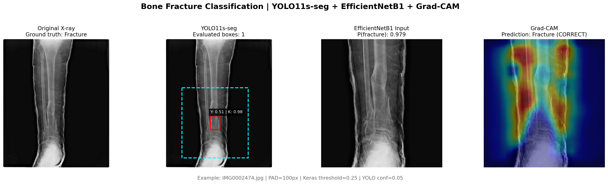
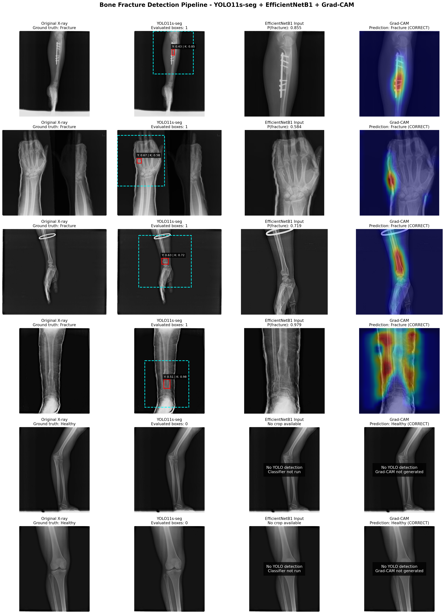

# Bone Fracture Classification with YOLO11s-seg and EfficientNetB1

A cascade for candidate fracture localization and binary X-ray classification, developed on **FracAtlas** in **Google Colab** as a bachelor's thesis project.

## Overview

**YOLO11s-seg** proposes candidate fracture regions. Although trained for segmentation, the cascade uses its bounding boxes to extract padded crops. **EfficientNetB1 (TensorFlow/Keras)** then scores each crop for fracture.

Candidates are ranked by YOLO confidence. Up to `TOP_K` crops are converted to RGB, resized to **640 x 640**, and processed with EfficientNet preprocessing. An image is classified as **Fracture** if any evaluated crop exceeds the classification threshold. If YOLO produces no candidates, the cascade returns **No Fracture** without running the classifier.

The classifier uses an ImageNet-pretrained EfficientNetB1 backbone with a custom binary classification head.

## Cascade Configuration and Results

| Parameter | Reported value |
|---|---|
| YOLO confidence threshold | `0.05` |
| `TOP_K` | `50` |
| Bounding box padding | `100` pixels per side, clipped to image boundaries |
| EfficientNetB1 classification threshold | `0.25` |

### Final test-set evaluation

| Accuracy | Fracture precision | Fracture recall | Fracture F1-score | Test images |
|---|---|---|---|---|
| **90.46%** | **71.43%** | **76.39%** | **73.83%** | **409** |

Precision, recall, and F1-score treat **Fracture** as the positive class. Accuracy covers both classes.

### Parameter selection and reproducibility

Bounding box padding and the classification threshold were tuned using **grid search on the validation set**. Validation selects the operating point; the chosen configuration is then fixed for final evaluation on the separate test set. The table reports final test performance, not validation search scores. Test results must not guide parameter selection.

**Reproducibility:** [pipeline_main.ipynb](pipeline_main.ipynb) contains the validation grid search, inference visualizations, and final evaluation. The search evaluates eight padding values (30, 60, 80, 100, 120, 150, 200, and 250 pixels) and classification thresholds from 0.15 to 0.85 in steps of 0.05, selecting the highest validation fracture F1-score. Its final grid-search evaluation successfully processes all 409 test images and records the confusion matrix: TN = 315, FP = 22, FN = 17, TP = 55, consistent with the metrics above.

The existing `pipeline.ipynb` preserves an earlier experiment with different settings. Its saved output excludes 10 images after read failures and covers 399 images. The initial inference cell in `pipeline_main.ipynb` also retains a 399-image output; the results reported here come from its later, complete grid-search evaluation.

### Interpreting errors

- **False positive:** a no-fracture image is classified as fracture, potentially prompting unnecessary review or follow-up.
- **False negative:** a fracture image is classified as no fracture, either because localization missed it or because the classifier score was too low.
- **Fracture recall** measures the proportion of actual fracture images detected. It matters clinically because missed fractures can delay assessment and treatment. Lower thresholds can increase recall at the cost of more false positives; accuracy alone is insufficient on imbalanced data.

These are retrospective research results, **not evidence of clinical validation or readiness for clinical use**.

## Inference Visualization and Explainability

The figures show four stages:

| Stage | Interpretation |
|---|---|
| **Original X-ray** | Full input image, with its dataset ground-truth label for reference |
| **YOLO Detection** | Red candidate box and dashed cyan padded crop boundary; `Y` denotes YOLO confidence and `K` the classifier score |
| **EfficientNetB1 Classification** | Classifier input crop and fracture score, labeled `P(fracture)` in the figures |
| **Grad-CAM** | Heatmap over the classifier input highlighting regions contributing to the fracture score |

### Single-image showcase



### Pipeline gallery



**Grad-CAM is a post-hoc explainability method, not an additional trained classification layer or a third predictive model.** It uses gradients and convolutional feature maps from the trained classifier to visualize regions influencing its score. It does not alter predictions, establish fracture boundaries, or prove that the model uses clinically appropriate features. Scores labeled as probabilities are model outputs, not demonstrated calibrated clinical probabilities.

When YOLO produces no candidates, there is no classifier crop or Grad-CAM heatmap; the gallery marks these stages as skipped. These selected examples illustrate behavior and do not replace quantitative evaluation or error analysis.

## Existing Experiments

The original notebooks remain as experimental records. Tasks and evaluation conditions differ, so these historical results are not a controlled comparison with the updated cascade.

### Standalone models

| Experiment | Accuracy | Fracture precision | Fracture recall | Fracture F1-score |
|---|---|---|---|---|
| Single-class YOLO11s-seg (mask evaluation) | - | 68.80% | 52.17% | 59.59% |
| Standalone EfficientNetB1 classifier | 79% | 45% | 81% | 57% |

YOLO mask metrics assess localized instances; classifier and cascade metrics assess image-level decisions. Their precision and recall are not interchangeable.

### Multi-class YOLO segmentation

| Class | Precision | Recall | mAP50 (Mask) | mAP50-95 (Mask) |
|---|---|---|---|---|
| No Fracture | 95.22% | 97.51% | 98.58% | - |
| Fracture | 64.72% | 45.16% | 52.12% | - |
| Overall | - | - | 75.35% | 58.38% |

FracAtlas lacks real polygon annotations for healthy bones. This experiment assigned synthetic full-image masks to the No Fracture class, introducing a mask-shape shortcut rather than meaningful healthy-bone segmentation supervision. These results are not suitable for direct comparison with the cascade.

## Dataset and Splits

The notebooks use stratified train/validation/test splitting with `random_state=42`. Controlled undersampling of the training set addresses the original approximately **1:4.69 fracture-to-no-fracture imbalance**. The committed split CSV files contain:

| Split | Images |
|---|---|
| Training (after undersampling) | 1,722 |
| Validation | 408 |
| Test | 409 |

Training, parameter selection, and final evaluation have separate roles. Image split membership alone does not establish patient-level independence.

Dataset reference: Iftekharul Abedeen et al., *FracAtlas: A Dataset for Fracture Classification, Localization and Segmentation*, Scientific Data, 10, 2023. https://doi.org/10.1038/s41597-023-02432-4

## Repository Structure

```text
.
|-- assets/
|   |-- profile_showcase.png
|   `-- pipeline_gallery.png
|-- data_split/
|   |-- universal_train_split.csv
|   |-- universal_val_split.csv
|   `-- universal_test_split.csv
|-- YOLO_mask_export.ipynb    # COCO fracture polygons to YOLO labels
|-- YOLOundersampling.ipynb  # Single-class YOLO training and evaluation
|-- keras_test2.ipynb        # EfficientNetB1 training and evaluation
|-- pipeline.ipynb           # Earlier cascade experiment
|-- pipeline_main.ipynb      # Validation grid search, final evaluation, and Grad-CAM
|-- Yolo_mult.ipynb          # Multi-class segmentation experiment
|-- best.pt                 # YOLO checkpoint
`-- README.md
```

The main cascade experiment is documented in [pipeline_main.ipynb](pipeline_main.ipynb); earlier notebooks are retained for experimental context.

## Requirements and Usage

```bash
pip install ultralytics tensorflow keras scikit-learn numpy pandas pillow opencv-python matplotlib
```

Development used Google Colab with a Tesla T4 GPU (approximately 15 GB VRAM). The dependency list is not a pinned environment specification.

1. Obtain FracAtlas images and annotations. Adapt the Google Drive mounts and environment-specific data paths in the notebooks.
2. Use `YOLO_mask_export.ipynb` for label conversion and `YOLOundersampling.ipynb` for single-class localization training and evaluation.
3. Use `keras_test2.ipynb` for classifier training. Cascade inference requires a YOLO checkpoint and an EfficientNetB1 `.keras` checkpoint; the classifier checkpoint is not currently included in this repository.
4. Use `pipeline_main.ipynb` for validation grid search, final test evaluation, and Grad-CAM visualizations with the corresponding trained checkpoints. `pipeline.ipynb` retains the earlier cascade implementation.

## Limitations

- FracAtlas originates from Bangladeshi medical centers; generalization to other populations, acquisition systems, and clinical settings is unestablished.
- Class imbalance makes accuracy alone an incomplete performance measure.
- A fracture missed by the localization stage cannot be recovered by the crop classifier.
- Historical notebooks encountered unreadable images. Evaluation coverage and image-loading behavior must be documented for reproducibility.
- Grad-CAM is qualitative and may highlight confounding features; it is not clinical verification.
- Multi-class segmentation is limited by synthetic no-fracture masks.
- Free Google Colab GPU resources constrained development.

## Author

Radek Bártl — Bachelor's Thesis, Czech University of Life Sciences Prague (ČZU), 2026
